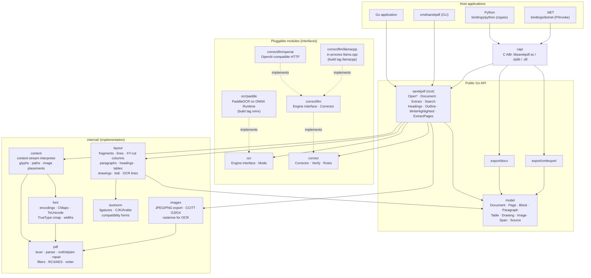
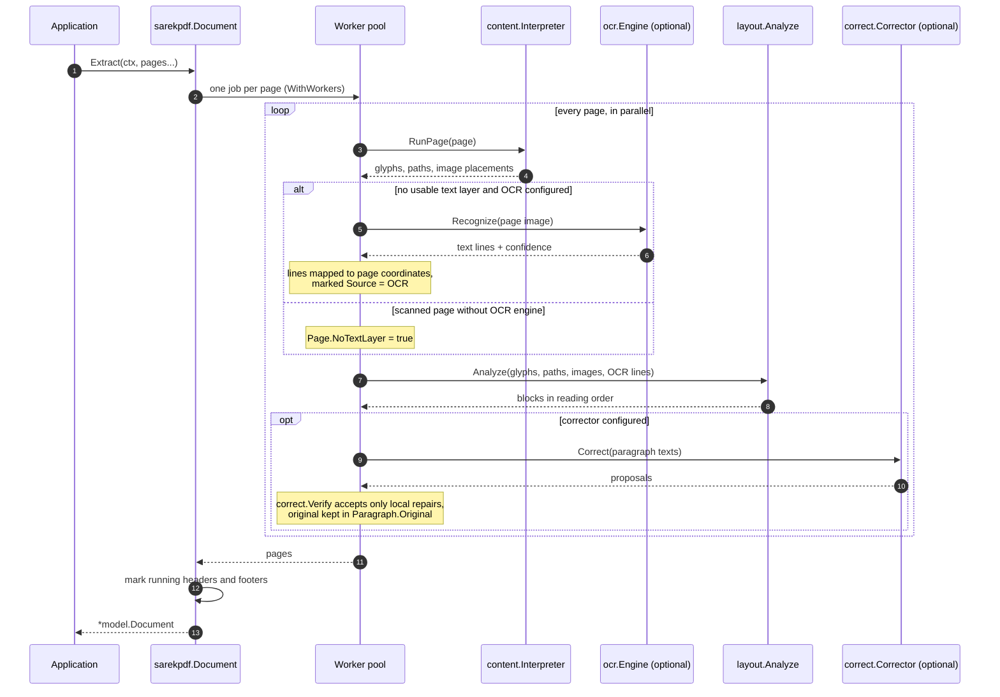
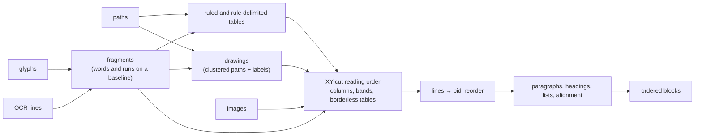
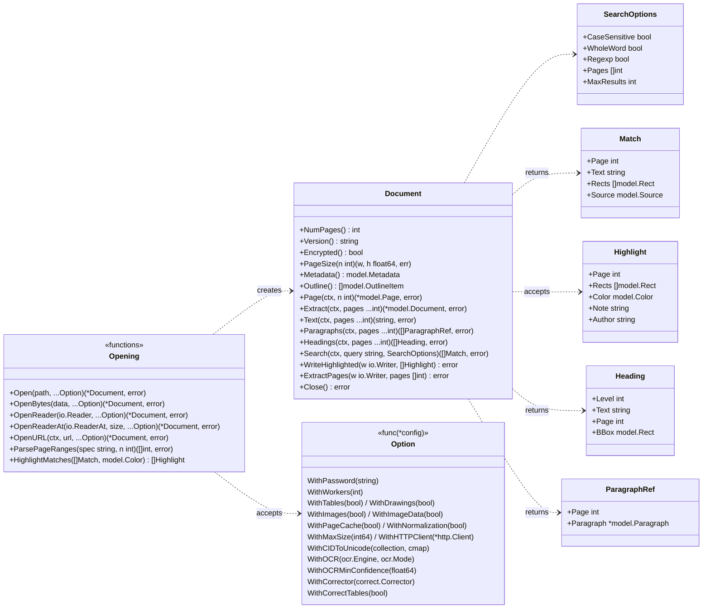
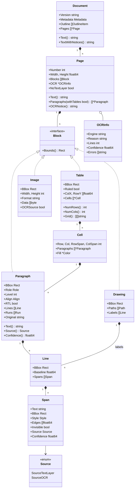
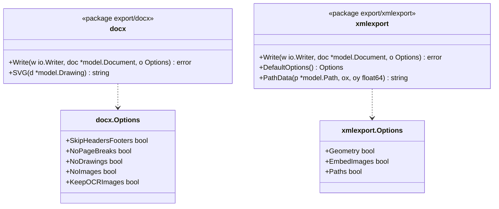
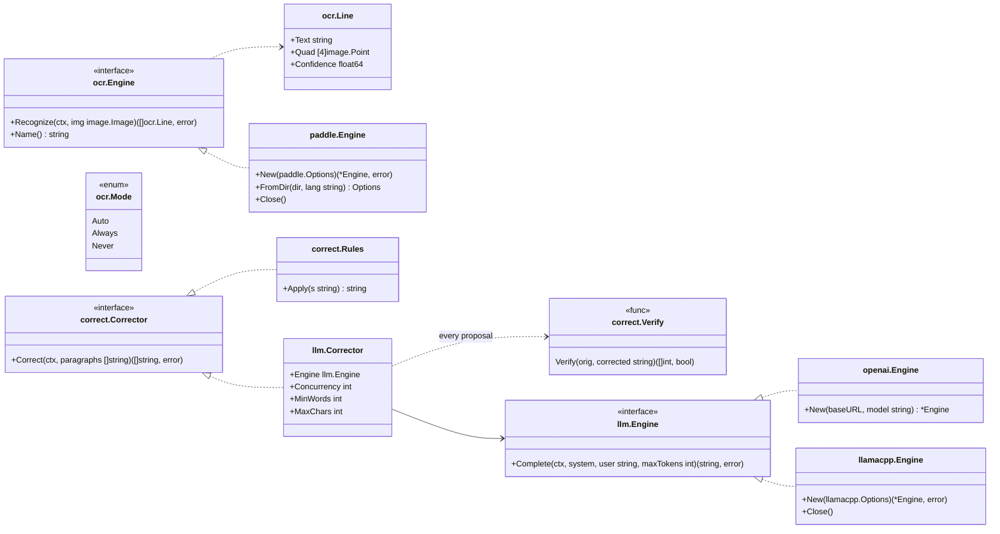
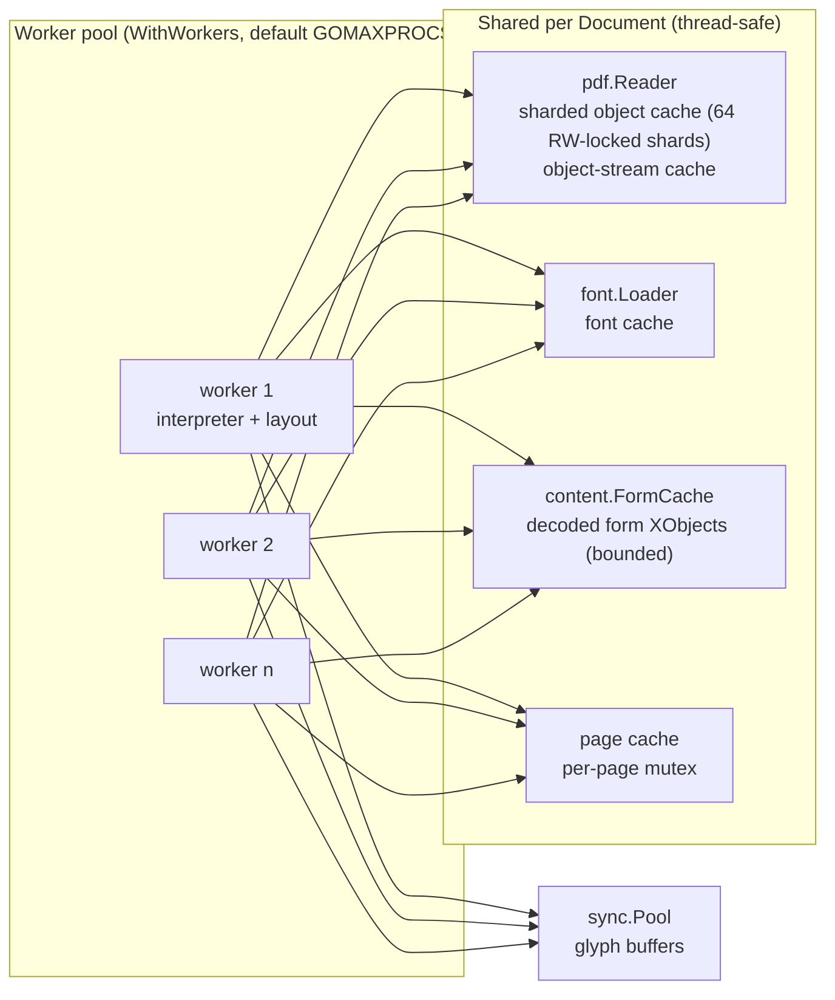
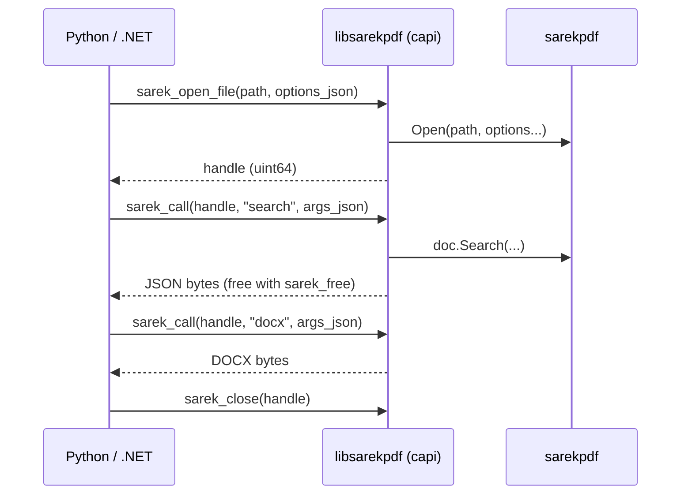

# sarek_pdf architecture

This document describes how sarek_pdf is structured, how a page flows through the
pipeline, and the public interfaces each package exposes. The binding rules that
shape these choices are in [CONSTITUTION.md](../CONSTITUTION.md).

- [1. Layers and packages](#1-layers-and-packages)
- [2. Page extraction pipeline](#2-page-extraction-pipeline)
- [3. Public interfaces](#3-public-interfaces)
- [4. Pluggable modules (OCR and language model)](#4-pluggable-modules-ocr-and-language-model)
- [5. Concurrency model](#5-concurrency-model)
- [6. Cross-language interface (C ABI)](#6-cross-language-interface-c-abi)

---

## 1. Layers and packages

Dependencies point downwards only. Everything under `internal/` is an implementation
detail; applications use the root package `sarekpdf`, `model`, the exporters and the
pluggable modules.

| Package | Responsibility |
|---|---|
| `internal/pdf` | Zero-copy lexer and parser, cross-reference tables and streams, object streams, hybrid files, automatic repair of broken files, stream filters (Flate, LZW, ASCII85, ASCIIHex, RunLength, predictors), standard security handler (RC4, AES-128, AES-256 R5/R6), object writer for incremental updates and page extraction. |
| `internal/font` | Simple and composite fonts: standard encodings, `Differences`, ToUnicode and CID CMaps, Unicode recovery from embedded TrueType/OpenType `cmap` tables, glyph widths. |
| `internal/content` | Executes content streams (text, paths, images, form XObjects, inline images) into positioned glyphs, vector paths and image placements in display coordinates. |
| `internal/layout` | Turns glyphs into words, lines and paragraphs; recursive XY-cut reading order (any number of columns); headings, lists, alignment; ruled, rule-delimited and borderless tables; vector drawings; right-to-left reordering; layout of OCR lines. |
| `internal/images` | Image export (JPEG pass-through, PNG), CCITT G3/G4 decoder, rasterisation of page images for OCR. |
| `internal/textnorm` | Deterministic normalisation tables (generated from the Unicode Character Database). |
| `sarekpdf` (root) | Public API: opening, parallel extraction, page cache, search, headings, outline, highlighting, page extraction, OCR and correction orchestration. |
| `model` | Plain-data result types shared by all exporters and bindings. |
| `export/docx`, `export/xmlexport` | Writers for DOCX and XML. |
| `ocr`, `ocr/paddle` | OCR module interface and the PaddleOCR/ONNX engine. |
| `correct`, `correct/llm/...` | Correction interface, zero-hallucination guard and language-model engines. |
| `capi`, `bindings/*`, `cmd/sarekpdf` | C ABI, Python and .NET bindings, command-line tool. |

---

## 2. Page extraction pipeline

`Document.Extract` distributes pages over a bounded worker pool. Each page runs the
pipeline below independently; results are cached per page.

Layout steps inside `layout.Analyze`:

---

## 3. Public interfaces

### 3.1 Root package `sarekpdf`

### 3.2 Result model (`model`)

### 3.3 Exporters

---

## 4. Pluggable modules (OCR and language model)

Both modules are interfaces. The core never depends on a concrete engine, so an
engine or model can be replaced without touching the library.

Guarantees enforced by the library, independent of the engine:

| Module | Guarantee |
|---|---|
| OCR | Runs only when configured (`WithOCR`). In `Auto` mode only on pages without a usable text layer. Every OCR span has `Source = SourceOCR` and a confidence; lines below `WithOCRMinConfidence` are dropped and reported; `Page.OCR` records engine, reason and mean confidence; exporters label OCR text. |
| Language model | Off by default. A proposal is accepted only if `correct.Verify` proves it is a local extraction repair (merge/split words, case, diacritics, hyphens, ligatures, `rn↔m`, `cl↔d`, `vv↔w`, `I↔l`; identical digits; no added, removed or reordered words). The original text is kept in `Paragraph.Original`. |

---

## 5. Concurrency model

- A `*Document` may be used by any number of goroutines at once; parsed objects are
  immutable after loading.
- Per-page state (interpreter, layout) is goroutine-local; glyph buffers are recycled
  through a `sync.Pool`.
- OCR and language-model engines must be safe for concurrent use; the provided ones are.
- All long operations take a `context.Context` and stop on cancellation.

---

## 6. Cross-language interface (C ABI)

| C function | Purpose |
|---|---|
| `sarek_open_file`, `sarek_open_bytes`, `sarek_open_url` | Open a document; return a handle. Options JSON: `password`, `workers`, `tables`, `drawings`, `images`, `ocr {models, lang, mode}`, `llm {url, model, concurrency}`. |
| `sarek_call(handle, op, args_json, &out, &len, &err)` | Operations: `info`, `text`, `xml`, `docx`, `paragraphs`, `headings`, `search`, `highlight`, `extract_pages`. |
| `sarek_close`, `sarek_free`, `sarek_version` | Release a handle, free returned buffers, report version. |

All functions are thread-safe, convert panics into errors, and copy input buffers so
the caller may free them immediately.
